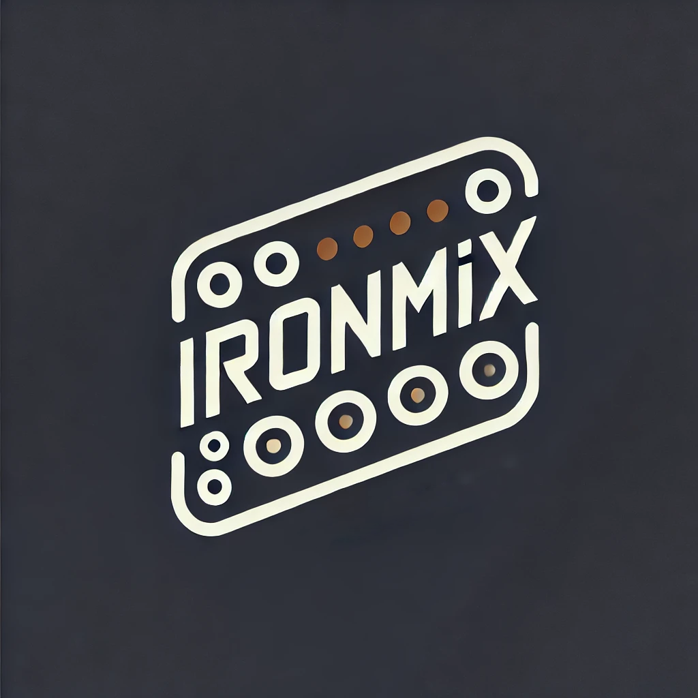
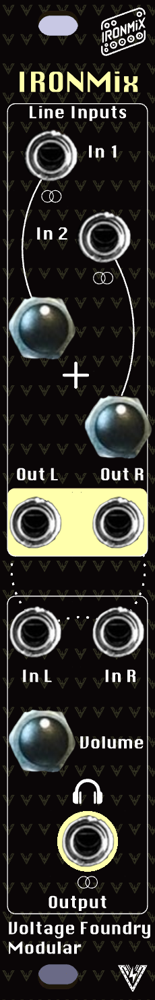
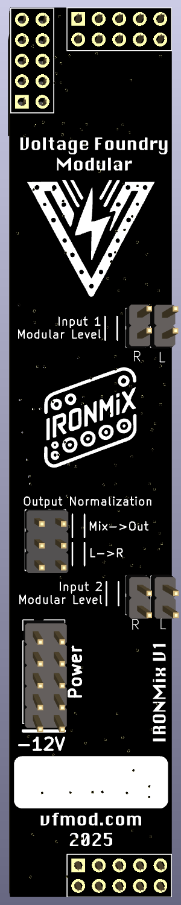
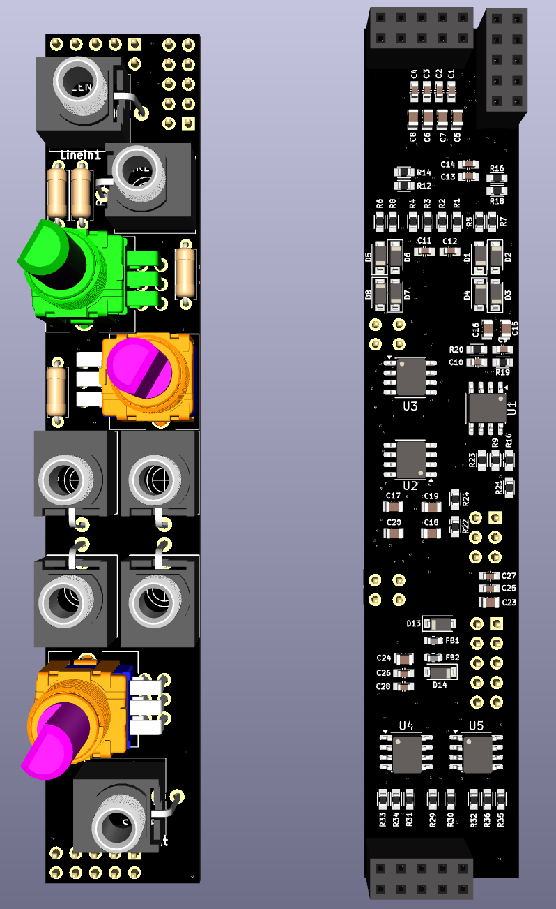
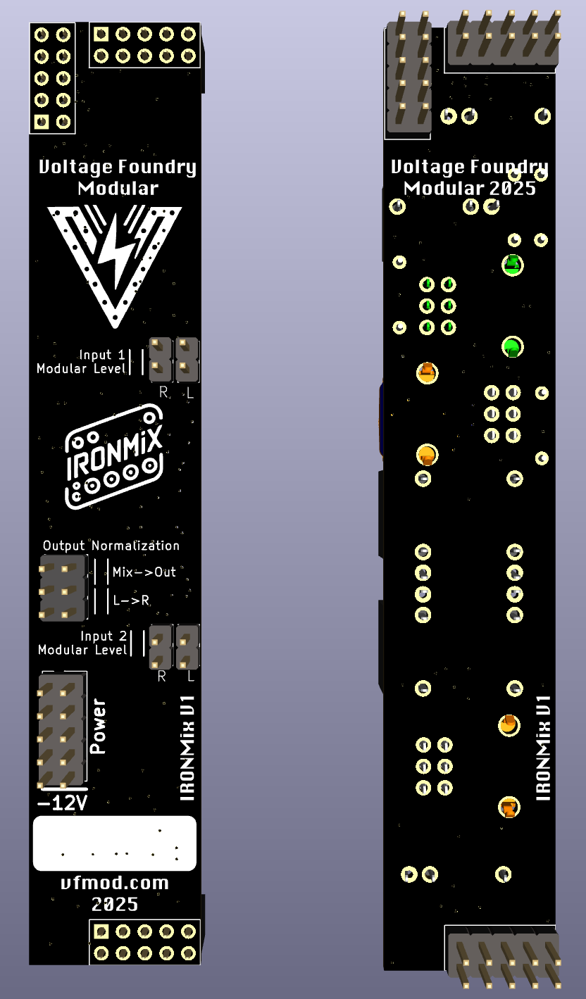

# IRONMix Eurorack Module

⚠️ The module is currently in a redesign phase and will be updated soon. Please do not build or order the current version. ⚠️

## Overview

Voltage Foundry Modular _IRONMix_ is a dual-function Eurorack Module in 4HP. It is a line in mixer with 2 stereo inputs and Left/Right modular-level outputs and in it's lower section it is an output module with Left/Right modular-level inputs and a stereo output capable of driving headphones or line-level gear.

## Features and Tips

- Two sections which can be used independently or together: a line in section and an output section.
- Line-in section with two stereo inputs, level controls, up to 40dB of gain, and 1MΩ input impedance and left/right modular-level outputs.
- Output section with two modular-level inputs for Left and Right channels, and a stereo output with volume control.
- Line level input is normalized to the output section, allowing the module to be used as a 2 stereo ins to stereo out mixer.
- Input section can be configured to accept line level or modular level signals, allowing the module to be used as a 2x left + 2x right mixer with modular level signals on the inputs and headphone/line level signals on the output.
- Output section right channel can be configured to be normalized to the left channel, allowing mono signals to be turned into stereo signals or normalized to the input section, allowing the module to be used as a 2 stereo ins to stereo out mixer.
- Stereo jacks on input section can be split with a stereo to 2x mono patch cable, allowing the module to be used as a 2x left + 2x right mixer with modular level signals on the inputs and headphone/line level signals on the output.

Check the module on [ModularGrid](https://modulargrid.net/e/other-unknown-ironmix-by-voltage-foundry-modular).

## Configuration

In the back of the module, the jumpers can be used to configure some aspects of the module. The jumpers are:

- **Output Normalization**: This jumper is used to configure the output section normalization. It can have three options (should be in pairs):
  - If the jumpers are in the "Mix-> Out" position, the mixed outputs of the line in section are connected to the output section effectively turning the module into a 2 stereo ins to stereo out mixer when nothing is connected.
  - If the jumpers are in the "L-> R" position, the left input of the output section is connected to the right input if it's not connected, turning mono input signals into stereo signals.
  - If no jumper is connected, the output section does not receive the signals from the inputs if nothing is connected.
- **Input 1/2 Level**: These jumpers are used in pairs to configure the input level of the line in section. If the jumper is not installed, the module accepts line level and even lower signals like guitars. If the jumper is installed, the module accepts modular level signals (10Vpp). This option together with a stereo to 2x mono patch cable can be used to make the module 2x left + 2x right mixer.

## Specifications

- **Width**: 4HP
- **Depth**: 30mm
- **Power**: +12V: XXXXmA, -12V: YYYYYmA
- **Input Impedance**: 1MΩ
- **Gain**: Up to 40dB
- **Input Level**: Line Level (2Vpp) or Modular Level (10Vpp)
- **Output Level**: Headphone/Line Level

## Power

The module uses a 10-pin Eurorack power connector and consumes XXXXmA of +12V and YYYYYmA of -12V. The module has a protection diode to prevent reverse polarity connection. The -12V side is indicated in the connector.

## Bill of Materials

In addition to the PCB, the following components are required to assemble the module:

| Quantity | Description                                                      |
| -------- | ---------------------------------------------------------------- |
| 4        | 510R resistor 1/8W 5%(or less)                                   |
| 3        | Stereo 3.5mm Thonkiconn jack (green)                             |
| 4        | Mono 3.5mm Thonkiconn jack (black)                               |
| 2        | 50kB 9mm Vertical dual gang potentiometer (linear stereo) RK09L  |
| 1        | 100KB 9mm Vertical dual gang potentiometer (linear stereo) RK09L |
| 4        | 2x5 pin header (2.54mm pitch)                                    |
| 3        | 2x5 female connector headers (2.54mm pitch)                      |
| 1        | 2x3 pin header (2.54mm pitch)                                    |
| 2        | 2x2 pin header (2.54mm pitch)                                    |

## Assembly Instructions

Most of the components are SMD and are already soldered to the PCB. The assembly process is simple and requires only a few components to be soldered. The components are:

**Front board (board that contains the jacks and potentiometers):**

- 4x 1/8W 5% 510R resistors (green, brown, brown, gold)
- 3x Stereo 3.5mm Thonkiconn jacks (green)
- 4x Mono 3.5mm Thonkiconn jacks (black)
- 2x 50kB 9mm Vertical dual gang potentiometers (linear stereo) RK09L
- 1x 100KB 9mm Vertical dual gang potentiometer (linear stereo) RK09L
- 3x 2x5 pin header for board interconnection (2.54mm pitch)

The placement of the components is indicated in the PCB. All components are mounted on the front side of the PCB except the pin headers which go on the back.

**Main board (board that contains the SMD components):**

- 1x 10-pin Eurorack power connector (2.54mm pitch)
- 3x 2x5 female connector headers for board interconnection (2.54mm pitch)
- 1x 2x3 pin header for the normalization jumper config (2.54mm pitch)
- 2x 2x2 pin header for the input level jumper config (2.54mm pitch)

The pin headers go on the back of the PCB (where the logos are) and the female connectors go in the front (where the SMD components are).

Refer to the pictures below for details:

To assemble the module, follow these steps:

1. Solder the 1/8W 5% 510R resistors to the front board.
2. Solder the 3.5mm jacks to the front board.
3. Solder the pin headers to the front board (back of the PCB).
4. Place the potentiometers in the front board but do not solder them yet.
5. Solder the female connectors to the main board (front of the PCB).
6. Solder the pin headers to the main board (back of the PCB).
7. Attach the front panel to the front board, aligning the potentiometers with the holes. Screw the potentiometers and jacks to the front panel.
8. Finish soldering the potentiometers to the front board.

## Version History

- **v1.0**: Initial release

## License

This project is licensed under the MIT License. See the `LICENSE` file for more information.

---

Thank you for choosing the IRONMix module. We hope it enhances your musical creativity and performance.
