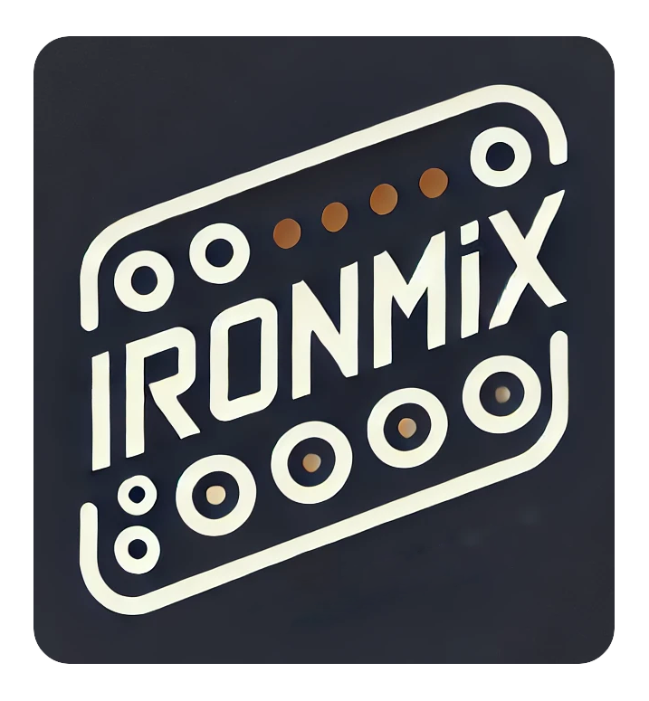
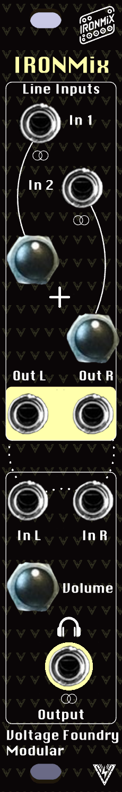

# IRONMix Eurorack Module

## Overview

Voltage Foundry Modular _IRONMix_ is a dual-function Eurorack Module in 4HP. It is a line in mixer with 2 stereo inputs and Left/Right modular-level outputs and in it's lower section it is an output module with Left/Right modular-level inputs and a stereo output capable of driving headphones or line-level gear.

## Features and Tips

- Two sections which can be used independently or together: a line in section and an output section.
- Line-in section with two stereo inputs, level controls, up to 40dB of gain, and 1MΩ input impedance and left/right modular-level outputs.
- Output section with two modular-level inputs for Left and Right channels, and a stereo output with volume control.
- Line level input is normalized to the output section, allowing the module to be used as a 2 stereo ins to stereo out mixer.
- Input section can be configured to accept line level or modular level signals, allowing the module to be used as a 2x left + 2x right mixer with modular level signals on the inputs and headphone/line level signals on the output.
- Output section right channel can be configured to be normalized to the left channel, allowing mono signals to be turned into stereo signals or normalized to the input section, allowing the module to be used as a 2 stereo ins to stereo out mixer.
- Stereo jacks on input section can be split with a stereo to 2x mono patch cable, allowing the module to be used as a 2x left + 2x right mixer with modular level signals on the inputs and headphone/line level signals on the output.

Check the module on [ModularGrid](https://modulargrid.net/e/other-unknown-ironmix-by-voltage-foundry-modular).

## Usage

For more details and usage instructions, see [Manual.md](Manual.md).

## Contact

For support and inquiries, please open an issue on the [GitHub repository](https://github.com/VoltageFoundryMod/IRONMix).

## License

This project is licensed under the MIT License. See the `LICENSE` file for more information.

---

Thank you for choosing the IRONMix module. We hope it enhances your musical creativity and performance.
